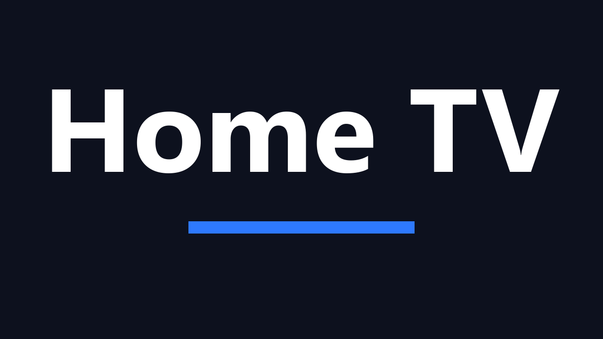

<div align="center">



# Home TV

**Live-Fernsehen auf dem Amazon Fire TV – direkt von der FRITZ!Box, ohne Server dazwischen.**

*Native Android/Fire-TV app that plays live TV straight from an AVM FRITZ!Box Cable (SAT>IP) – no streaming server, no transcoding.*

[Download](#download-und-installation) · [Funktionen](#funktionen) · [Bedienung](#bedienung) · [Selbst bauen](#selbst-bauen) · [Dokumentation](#dokumentation)

</div>

---

## Was ist Home TV?

Die **FRITZ!Box 6660 Cable** hat einen eingebauten DVB-C-Tuner und stellt ihre Sender per **SAT>IP** im Heimnetz bereit.
Home TV ist eine kleine App für den **Fire TV Stick**, die diese Sender wie bei einem Fernseher abspielt:
Sender wechseln mit der Fernbedienung, Senderliste, Programmübersicht (EPG) und Favoriten – alles direkt von der Box.

Unter der Haube arbeiten ein eigener SAT>IP-Client (RTSP + RTP/UDP, MPEG-TS) und **LibVLC** als Player.
Es wird nichts umkodiert; Bild und Ton kommen unverändert von der Box.

> **Status:** Die App läuft im Alltag auf einem **Fire TV Stick 4K Max (Fire OS 8)** mit einer **FRITZ!Box 6660 Cable** –
> Bild, Ton, Synchronisation und Senderwechsel sind dort getestet. Andere Fire-TV-Modelle und andere SAT>IP-Server sind **nicht getestet**.
> Details: [Teststatus](#teststatus).

## Funktionen

**Fernsehen**
- Live-TV mit Hardware-Decoder, Ton und Bild synchron; ca. **2–5 s** vom Einschalten bzw. Senderwechsel bis zum Bild.
- **Schnelles Umschalten:** Beim Drücken von ▲/▼ bzw. CH+/CH− erscheint sofort Nummer, Name und laufende Sendung; geladen wird erst nach einer kurzen Pause – mehrfaches schnelles Drücken startet genau *einen* Sender, alte Verbindungen werden sauber beendet.
- Start mit dem **zuletzt gesehenen Sender**; Pause (Standbild) und „live neu starten".

**Sender, Programm, Favoriten**
- **Senderliste** am rechten Rand mit Nummer, Name, laufender Sendung, Fortschrittsbalken, Restzeit und Uhr.
- **Programmübersicht** im Vollbild: alle Sender als Raster mit Zeitachse – *Gelaufenes, Laufendes und Kommendes*, Detailansicht der gewählten Sendung.
- **Programmführer (EPG)** über eine **frei einstellbare XMLTV-URL** (keine voreingestellt): lokal zwischengespeichert, bedingte Aktualisierung, bei Fehlern bleiben die alten Daten.
- **Favoriten** (★): per langem OK setzen, **Favoriten-Leiste** mit einer Taste, Filter „nur Favoriten" – auch beim Umschalten mit CH±.

**Bedienung und Einstellungen**
- Dunkle TV-Oberfläche, komplett mit der Fernbedienung bedienbar; **Anleitung mit Tastensymbolen** in den Einstellungen.
- Zehn Einstellungsbereiche: u. a. Puffer, Audio-Versatz, **Kanaltasten vertauschen**, Umspringen am Listenende, eigene **FRITZ!Box-Adresse** oder **eigene Senderliste (M3U mit `rtsp://`-Adressen)**, Zurücksetzen mit Sicherheitsabfrage.
- Optionaler Timer „Automatisch beenden nach …" (gibt den Tuner der Box frei).
- **Debug-Modus** (standardmäßig aus) mit technischem Overlay; technische Logs werden immer lokal geschrieben.

## Voraussetzungen

| | |
|---|---|
| Gerät | Amazon **Fire TV** (Fire OS 5 / Android 5.1 oder neuer; getestet: Fire TV Stick 4K Max, Fire OS 8). Auch auf anderen Android-TV-Geräten startbar (Leanback), dort ungetestet. |
| Quelle | **FRITZ!Box mit DVB-C-Tuner** (getestet: 6660 Cable), im selben Netz wie das Fire TV. Standardadresse `192.168.200.1`, in den Einstellungen änderbar. |
| Netz | Die Box liefert RTP nur über **UDP**. Steht ein Router mit zustandsbehafteter Firewall dazwischen, braucht der Client einen „Punch" – das macht die App selbst. |

## Download und Installation

Die fertige, signierte APK liegt im Ordner [`release/`](release/): **`HomeTV-1.5.0.apk`** (Version 1.5.0).
Bequemer ist der Bereich **[Releases](https://github.com/TheCraftedTech/HomeTV/releases)** dieses Repositories, sobald dort ein Release angelegt ist.

**Prüfsumme (SHA-256):** `9da72b6a7b843c0fbb25dee0435d8ddcf57199c46825baf5ae488e10d612a21a` (auch in `release/HomeTV-1.5.0.apk.sha256`).
**Signaturzertifikat (SHA-256):** `cbd3c2524c9a792f649e83683b165feb04c1dc5d935e0a5906bf9f8dc37383e5` – prüfbar mit `apksigner verify --print-certs HomeTV-1.5.0.apk`.

### Variante A – mit ADB vom PC (am zuverlässigsten)
1. Am Fire TV: *Einstellungen → Mein Fire TV → Info* → 7× auf den Gerätenamen drücken (Entwickleroptionen), dann *Entwickleroptionen → ADB-Debugging* **an**. IP-Adresse unter *Info → Netzwerk* ablesen.
2. Am PC (Android Platform-Tools):
   ```
   adb connect <FIRE-TV-IP>:5555
   adb -s <FIRE-TV-IP>:5555 install -r HomeTV-1.5.0.apk
   ```
   `-r` aktualisiert eine vorhandene Version und behält Einstellungen und Favoriten.
3. Starten: Fire TV → *Apps* → **Home TV** (neu installierte Apps stehen oft ganz hinten).

### Variante B – ohne PC mit der App „Downloader"
1. Fire TV: *Einstellungen → Mein Fire TV → Entwickleroptionen → Apps unbekannter Herkunft* für **Downloader** erlauben, Downloader aus dem Appstore installieren.
2. In Downloader die Adresse der APK eingeben (Release-Download oder die „Raw"-Adresse der Datei in `release/`) und installieren.
   *(Dieser Weg ist hier nicht getestet.)*

> **Hinweis zur Signatur:** Die APK ist mit dem Schlüssel des Autors signiert. Wer die App selbst baut, signiert mit einem eigenen Schlüssel –
> eine selbst gebaute Version lässt sich dann nur nach **Deinstallieren** der Original-App installieren (und umgekehrt).

### Erste Schritte
1. FRITZ!Box: Die Box muss DVB-C-Sender empfangen (Sendersuchlauf eingerichtet) und die Senderliste unter `/dvb/m3u/` bereitstellen. Im Testaufbau war dafür keine zusätzliche Einstellung nötig; wie das bei anderen Boxen/Firmwareständen ist, ist ungetestet.
2. Home TV starten – die Senderliste wird von `http://<Box>/dvb/m3u/tvhd.m3u` und `tvsd.m3u` geladen. Andere Adresse: *Einstellungen → Sender*.
3. Optional **Programmführer**: *Einstellungen → Programmführer → XMLTV-URL* eintragen (Adresse einer XMLTV-Datei, auch `.xml.gz`). Eine passende Quelle musst du selbst wählen; es ist keine voreingestellt. Die Zuordnung zu den Sendern läuft über Namen (siehe [docs/epg.md](docs/epg.md)).

## Bedienung

| Taste | Aktion |
|---|---|
| ▲ / CH+ · ▼ / CH− | Sender wechseln (Gedrückthalten = schneller, am Ende springt es um) |
| ▶ | Senderliste |
| ◀ oder Menü | Einstellungen |
| OK | Info-Leiste mit laufender Sendung |
| **OK lange drücken** oder ⏪ | **Programmübersicht** |
| ⏩ | **Favoriten-Leiste** |
| Play/Pause | Standbild / live neu starten |
| Zurück | schließen, sonst beenden |
| *In Liste/Übersicht:* OK lang · Menü | ★ Favorit setzen/entfernen · „nur Favoriten" ein/aus |

Alle Tasten mit Symbolen: *Einstellungen → Anleitung → Tastenbelegung anzeigen* bzw. [docs/ui-and-controls.md](docs/ui-and-controls.md).
Power-, Lautstärke- und Home-Taste werden von Fire OS nicht an Apps weitergegeben ([docs/firetv-limits.md](docs/firetv-limits.md)).

## Selbst bauen

Voraussetzungen: **JDK 21**, Windows (die Skripte sind `.bat`; der Gradle-Build selbst ist plattformunabhängig). Android SDK, Gradle-Cache und ADB werden **im Projektordner** abgelegt, nichts wird global installiert.

```
scripts\build-release.bat            → build\HomeTV.apk   (signiert, Version aus app/build.gradle.kts)
gradlew testDebugUnitTest            → Unit-Tests
```
Für ein signiertes Release braucht es `keystore.properties` und einen Keystore (beides **nicht** im Repository, siehe [docs/build-and-install.md](docs/build-and-install.md), Abschnitt „Signierschlüssel").
Ohne Schlüssel lässt sich ein Debug-Build mit `gradlew assembleDebug` erzeugen. Andere Standardadresse der Box: `-PfritzboxHost=192.168.x.y`.
Stack: Kotlin 2.2, AGP 8.9, Gradle 8.13, compileSdk 36 / targetSdk 34 / minSdk 22, LibVLC 3.7.7.

## Dokumentation

| Datei | Inhalt |
|---|---|
| [docs/architecture.md](docs/architecture.md) | Bausteine, Threads, Senderwechsel/Abbruch, Tests |
| [docs/ui-and-controls.md](docs/ui-and-controls.md) | Oberfläche, Tastenbelegung, Einstellungen, Favoriten, Programmübersicht |
| [docs/epg.md](docs/epg.md) | XMLTV-Programmführer: Format, Zuordnung, Cache, Aktualisierung |
| [docs/player-technology.md](docs/player-technology.md) | Warum LibVLC + eigener SAT>IP-Client (Entscheidung und Messungen) |
| [docs/stream-analysis.md](docs/stream-analysis.md) | Messungen am Stream der FRITZ!Box (Verlust, Jitter, Startzeit, Senderwechsel) |
| [docs/firetv-setup.md](docs/firetv-setup.md) · [docs/firetv-limits.md](docs/firetv-limits.md) | ADB-Einrichtung · Eigenheiten von Fire OS (Tasten, Icon-Cache, Launcher) |
| [docs/build-and-install.md](docs/build-and-install.md) | Bauen, Signieren, Installieren |
| [CHANGELOG.md](CHANGELOG.md) | Versionsverlauf |

Messwerkzeuge (nur lesend gegen die Box): `tools/` (`udp_analyze.py`, `ts_sync_check.py`, `ts_cc_events.py`, `startup_timeline.py`, `rtsp_probe.py`), Hilfsskripte in `scripts/` (Log abholen, UDP-Verluste, Tastenmonitor).

## Teststatus

| Ebene | Status |
|---|---|
| Wiedergabe auf dem Fire TV (Bild, Ton, Synchronisation, Senderwechsel, Oberfläche, Programmübersicht, Favoriten) | ✅ vom Autor im Alltag getestet (Fire TV Stick 4K Max, FRITZ!Box 6660 Cable) |
| Unit-Tests (Senderwechsel/Abbruch, Einstellungen, Menü-Bedienung, XMLTV-Parser, Zuordnung, EPG-Cache, Favoriten, Raster-Navigation, Anleitung, …) | ✅ **155 Tests** (+ 2 Live-Tests gegen die Box, nur mit `HOMETV_LIVE_TEST=1`) |
| Programmführer mit echter XMLTV-Quelle über längere Zeit | ⚠ nur teilweise getestet (Parser/Zuordnung/Cache sind unit-getestet) |
| Andere Fire-TV-Modelle, andere SAT>IP-Server, eigene M3U-Quellen | ⬜ nicht getestet |
| Dauerbetrieb über viele Stunden, Puffervergleich 1–5 s | ⬜ nicht systematisch getestet |

## Bekannte Einschränkungen

- **Senderwechsel** aus laufender Wiedergabe dauert ca. 2 s länger als der erste Start (der LibVLC-Stopp blockiert ~2 s; Ursache nicht abschließend geklärt, siehe [docs/stream-analysis.md](docs/stream-analysis.md) §15).
- **Power-/Lautstärke-/Home-Taste** erreichen Apps unter Fire OS nicht; bei ausgeschaltetem Fernseher bleibt der Fire TV an (CEC-Einstellung) – dafür gibt es den optionalen Timer „Automatisch beenden nach …".
- **App-Icon und Optionsmenü der Kachel** (z. B. „Deinstallieren") können bei per ADB installierten Apps im Launcher veraltet bzw. eingeschränkt sein (Appstore-Cache) – Ursache und Auswege in [docs/firetv-limits.md](docs/firetv-limits.md). Deinstallieren geht über *Einstellungen → Anwendungen*.
- Pause = Standbild; Fortsetzen startet live neu (**kein Timeshift**). Keine Untertitel, keine Tonspurauswahl, keine Aufnahmen.
- Eine eigene Senderliste muss `rtsp://`-SAT>IP-Adressen enthalten; Senderlogos sind in der M3U der FRITZ!Box nicht vorhanden und werden nicht angezeigt.
- Ohne Code-Verkleinerung (R8 aus); die APK ist wegen LibVLC (zwei ABIs) ca. 46 MB groß.

## Datenschutz

Die App sammelt nichts und sendet nichts an Dritte. Netzwerkzugriffe gehen nur an die **FRITZ!Box** (Senderliste, Fernsehstrom) und – falls eingetragen – an die von dir gewählte **XMLTV-** bzw. **M3U-Adresse**.
Das App-Log liegt lokal auf dem Gerät und verlässt es nur, wenn du es selbst abholst (`scripts\pull-log.bat`).

## Lizenz und Drittsoftware

- **Quellcode dieses Projekts:** Noch keine Lizenz festgelegt – bis eine `LICENSE`-Datei hinzugefügt wird, gelten die gesetzlichen Standardrechte des Autors (alle Rechte vorbehalten).
- **LibVLC** (VideoLAN) steht unter der **GNU LGPL 2.1** und ist in der APK enthalten – Hinweise und Quellen in [THIRD_PARTY_NOTICES.md](THIRD_PARTY_NOTICES.md).
- „FRITZ!Box" ist eine Marke der AVM GmbH, „Fire TV" und „Amazon" sind Marken von Amazon.com, Inc., „VLC" von VideoLAN. Dieses Projekt steht in keiner Verbindung zu diesen Unternehmen.

## Autor

**Samuel Zenker** · [TheCraftedTech](https://github.com/TheCraftedTech)
